# Lab 12 – Windows Account Management Auditing

## Objective

Configure Advanced Audit Policy to monitor Active Directory user account and security group changes. Verify the audit settings and investigate the resulting Security events to identify who performed account management activities and which accounts or groups were affected.

## Environment

- Domain: `corp.northstar.local`
- Domain Controller: `WIN-SRV-DC01`
- Client: `WIN-CLIENT01`
- Operating System: Windows Server 2022
- Group Policy: `NorthStar - Windows Account Management Auditing`

## 1. Created and Linked a Dedicated GPO

Created a new Group Policy Object named:

`NorthStar - Windows Account Management Auditing`

Linked the GPO to the Domain Controllers OU in `corp.northstar.local`.

The existing Group Policy Objects were left unchanged.

## 2. Configured User Account Management Auditing

Navigated to:

`Computer Configuration > Policies > Windows Settings > Security Settings > Advanced Audit Policy Configuration > System Audit Policies > Account Management`

Opened **Audit User Account Management** and configured:

- Success: Enabled
- Failure: Disabled (left unchecked)

This setting records successful changes to Active Directory user accounts, including account creation, modification, enablement, disablement, and deletion.

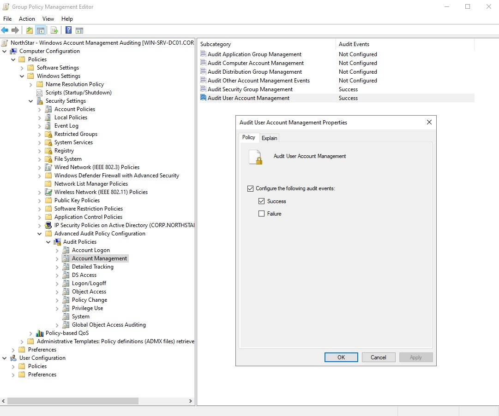

## 3. Configured Security Group Management Auditing

Under the Account Management audit category, opened **Audit Security Group Management** and configured:

- Success: Enabled
- Failure: Disabled (left unchecked)

This setting records changes to security groups, including membership additions, removals, and group deletion.

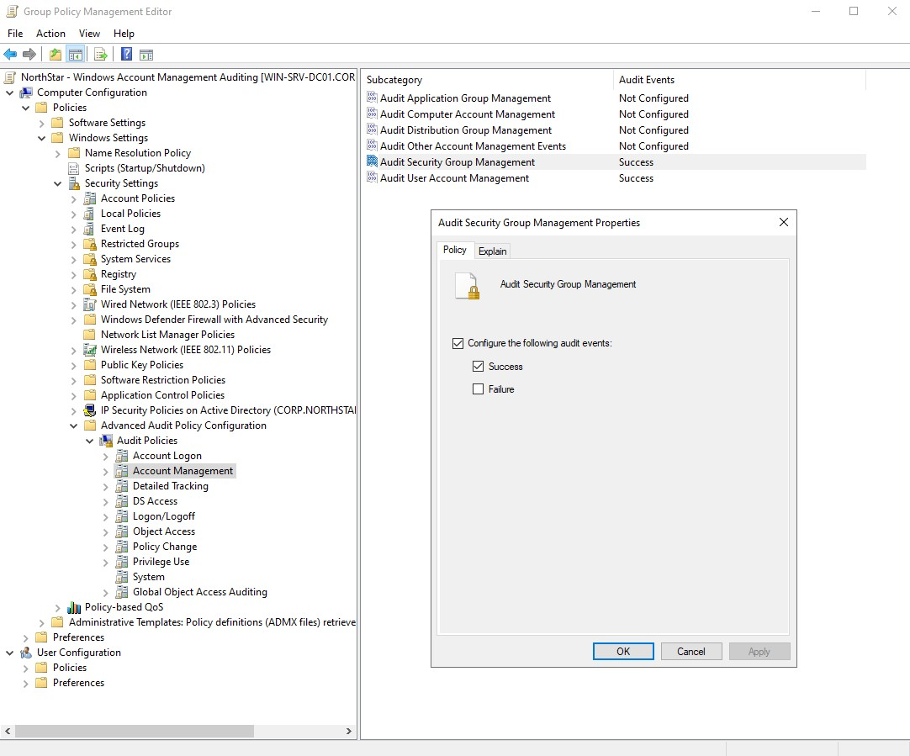

## 4. Applied and Verified Group Policy

Applied the updated Group Policy configuration on `WIN-SRV-DC01` using:

`gpupdate /force`

Verified the applied GPO using:

`gpresult /r /scope computer`

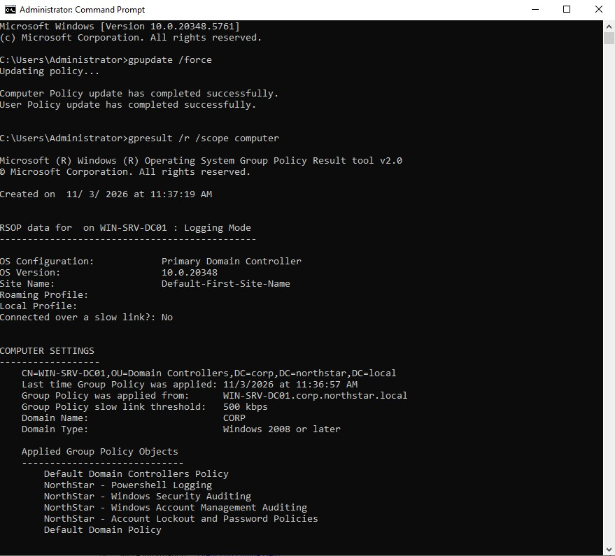

Confirmed that `NorthStar - Windows Account Management Auditing` appeared under Applied Group Policy Objects.

Also used the following commands to check the effective audit settings:

```powershell
auditpol /get /subcategory:"User Account Management"

auditpol /get /subcategory:"Security Group Management"
```
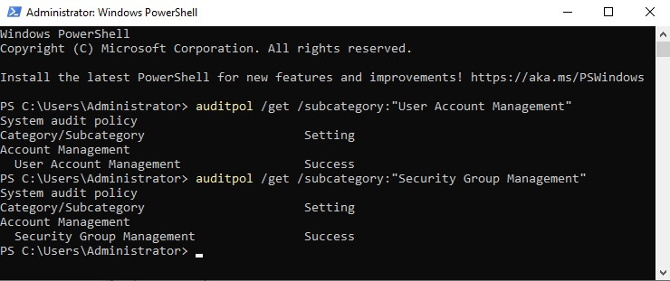

Both audit subcategories showed Success enabled.

## 5. Created a Test Domain Account

Created a dedicated test account named `LabAccountAuditTest` under the `NorthStar Users` organizational unit.

The account was configured as a standard domain user without administrative privileges.

A password meeting the domain password policy established in Lab 11 was assigned.

Reviewed the resulting account creation event in Event Viewer.

**Event ID 4720 – A user account was created.**

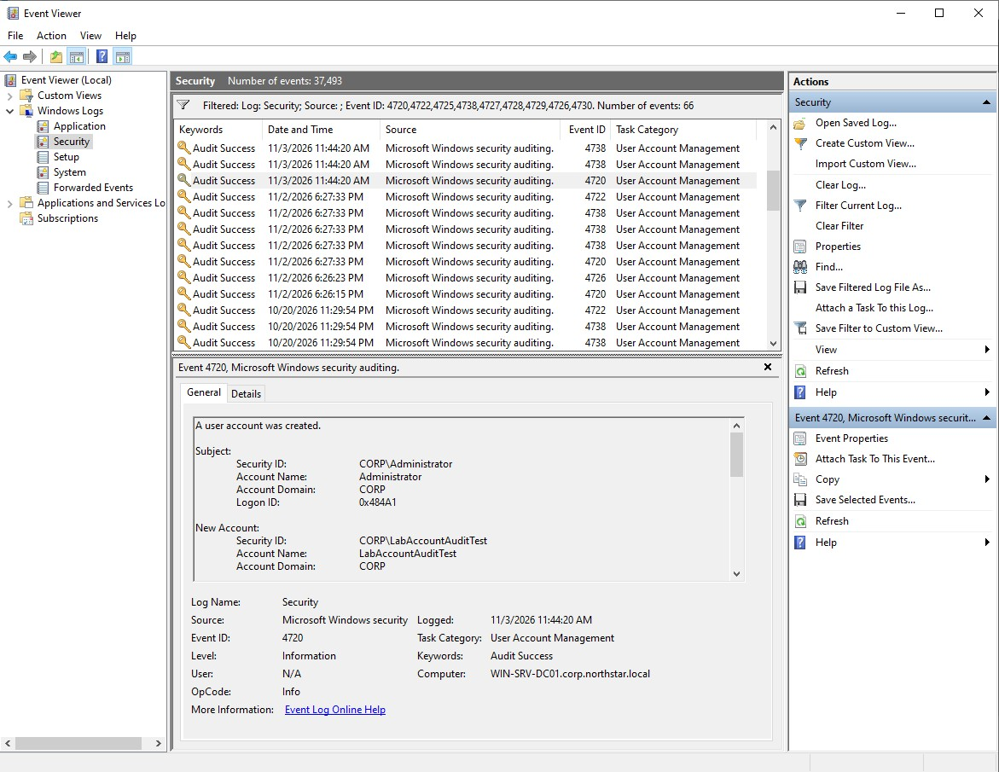

## 6. Tested User Account Changes

Used Active Directory Users and Computers to perform several changes to `LabAccountAuditTest`.

The following activities were performed:

**Modified the user account**

Updated the Description field in the account's Properties.

- Event ID 4738 – A user account was changed.

**Disabled the user account**

Used the Disable Account option in Active Directory Users and Computers.

- Event ID 4725 – A user account was disabled.

**Enabled the user account**

Used the Enable Account option to restore the account.

- Event ID 4722 – A user account was enabled.

Reviewed the corresponding events in the Windows Security log.

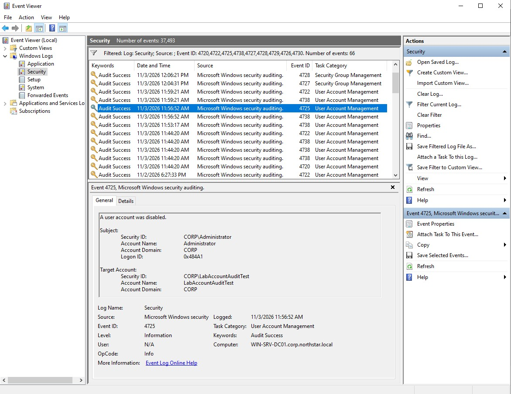

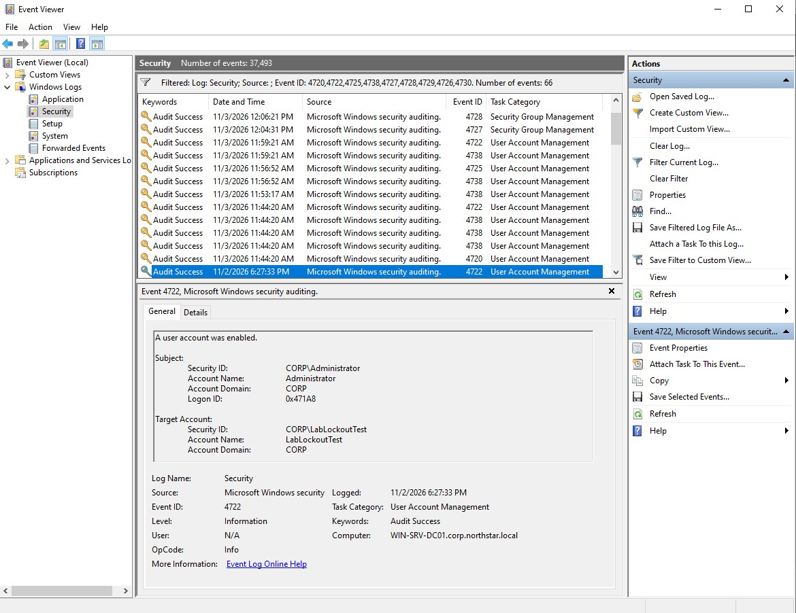

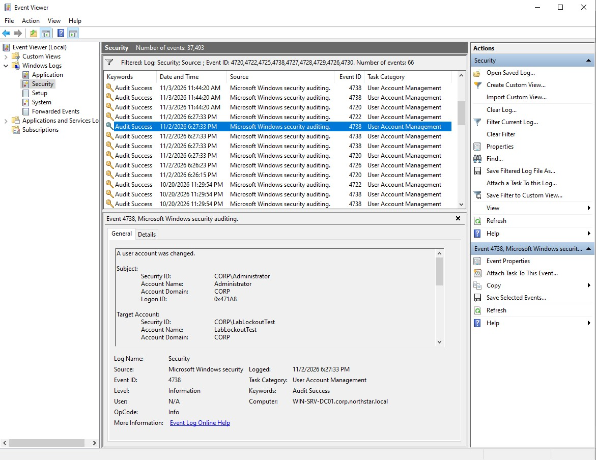

## 7. Tested Security Group Membership Changes

Created a global security group named:

`Lab12-Test-Access`

Added `LabAccountAuditTest` as a member of the group through Active Directory Users and Computers.

Reviewed the resulting Security event:

- Event ID 4728 – A member was added to a security-enabled global group.

Removed `LabAccountAuditTest` from the group and reviewed:

- Event ID 4729 – A member was removed from a security-enabled global group.

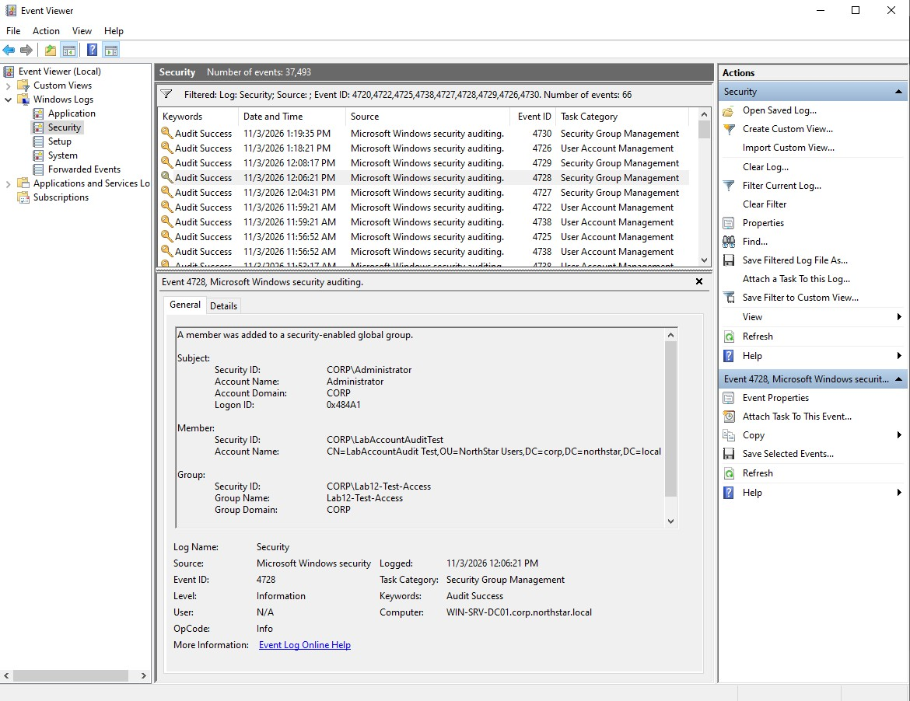

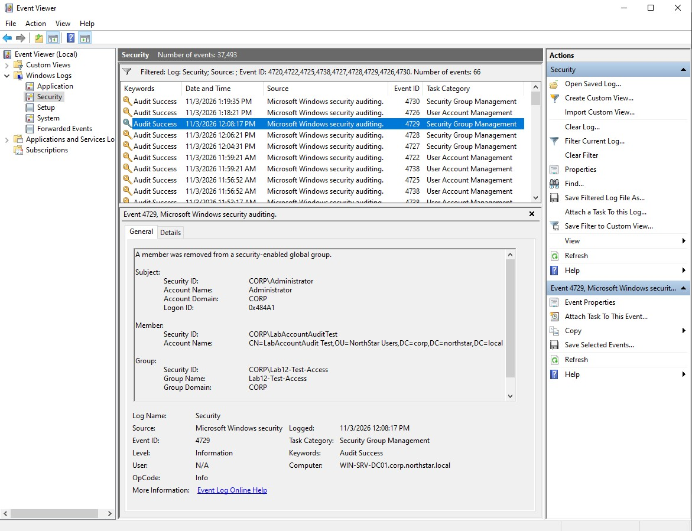

## 8. Reviewed Account and Group Deletion Events

After completing the account and group membership tests, deleted the temporary test objects through Active Directory Users and Computers.

**User account deletion**

Deleted `LabAccountAuditTest` from the `NorthStar Users` organizational unit.

- Event ID 4726 – A user account was deleted.

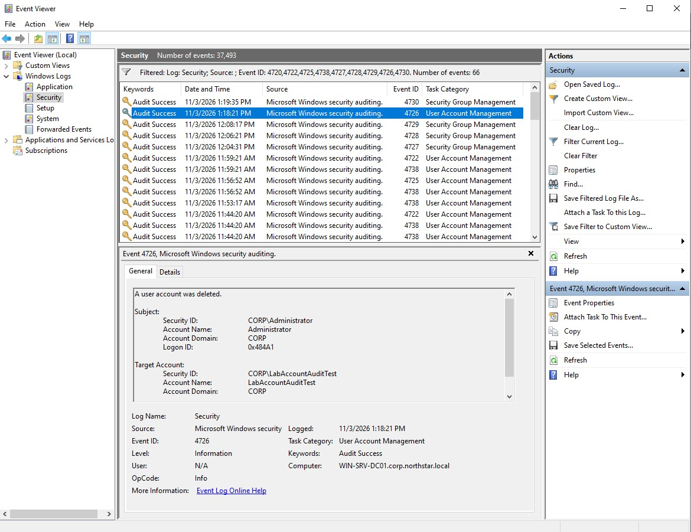

**Security group deletion**

Deleted the temporary global security group `Lab12-Test-Access`.

- Event ID 4730 – A security-enabled global group was deleted.


## 9. Findings

The investigation demonstrated that:

- Advanced Audit Policy can record changes to Active Directory user accounts and security groups.
- Event ID 4720 records user account creation.
- Events 4722 and 4725 record account enablement and disablement.
- Event ID 4738 records changes to user account properties.
- Events 4728 and 4729 record security group membership additions and removals for global security groups.
- Event IDs 4726 and 4730 record user account and security group deletion.
- Security events contain information about the account performing an action and the account or group affected.

## Conclusion

Configured and verified User Account Management and Security Group Management auditing through Group Policy.

Tested account creation, modification, enablement, and disablement, along with security group membership changes. Reviewed the resulting Security events to identify the accounts affected and the administrative actions performed.

Also verified the events generated when the test account and security group were deleted.
