# Lab 13 – Advanced Group Policy Security Settings

## Objective

Configure selected Windows security settings through Group Policy and apply them to a specific domain-joined workstation. Verify that the policies are applied to the intended computer and test the resulting Windows sign-in behavior.

## Environment

- Domain: `corp.northstar.local`
- Domain Controller: `WIN-SRV-DC01`
- Client: `WIN-CLIENT01`
- Operating System: Windows Server 2022 and Windows 11
- Group Policy: `NorthStar - Advanced Group Policy Security Settings`

## 1. Created a Workstation Security Group

Created a global security group named `Lab13-Workstations` under the `NorthStar Users` organizational unit.

Added the computer account `WIN-CLIENT01` to the group.

This group was used to control which computer would receive the new Group Policy Object through Security Filtering.

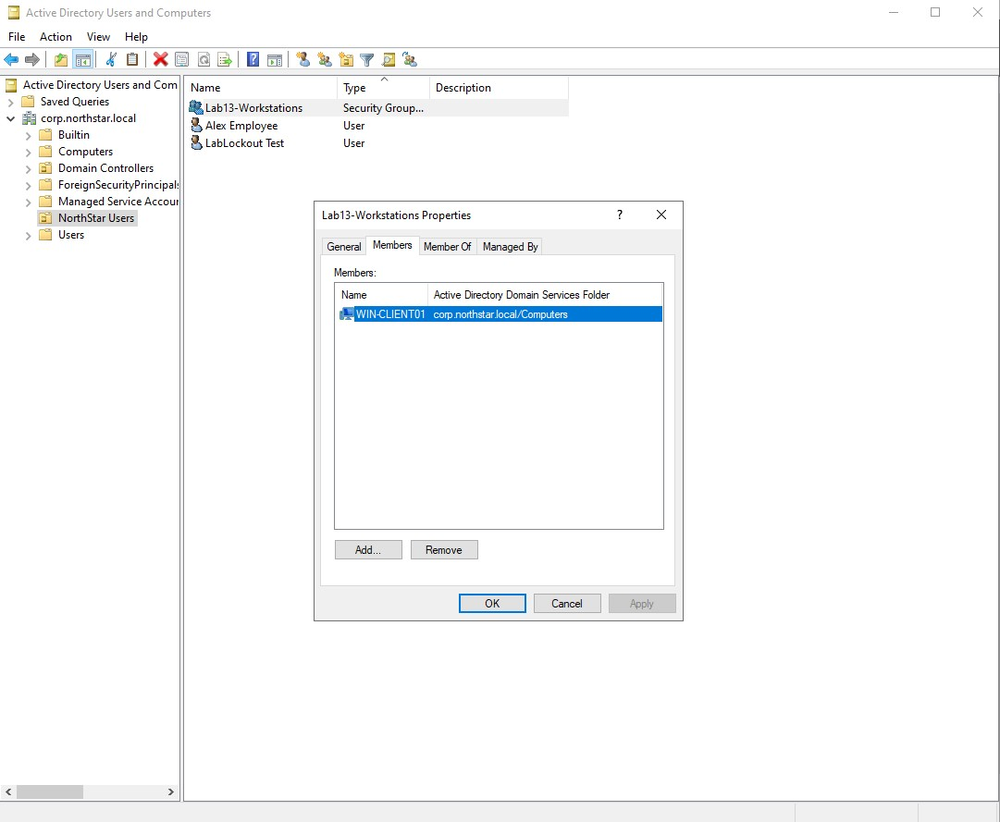

## 2. Created and Linked a Dedicated GPO

Created a new Group Policy Object named:

`NorthStar - Advanced Group Policy Security Settings`

Linked the GPO at the domain root of `corp.northstar.local`.

Configured Security Filtering to use `Lab13-Workstations` and removed `Authenticated Users` from the filtering list.

This restricted the GPO to the designated workstation group while leaving the existing Group Policy Objects unchanged.

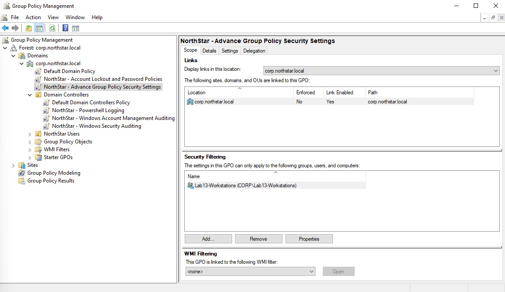

### Verified GPO Permissions

Reviewed the GPO's Delegation settings to verify that `Lab13-Workstations` had the required Read and Apply Group Policy permissions.

Also used PowerShell on `WIN-SRV-DC01` to verify the permissions:

```powershell
Get-GPPermission -Name "NorthStar - Advanced Group Policy Security Settings" -TargetName "Lab13-Workstations" -TargetType Group
```

The output identified `Lab13-Workstations` as a group with the `GpoApply` permission level.

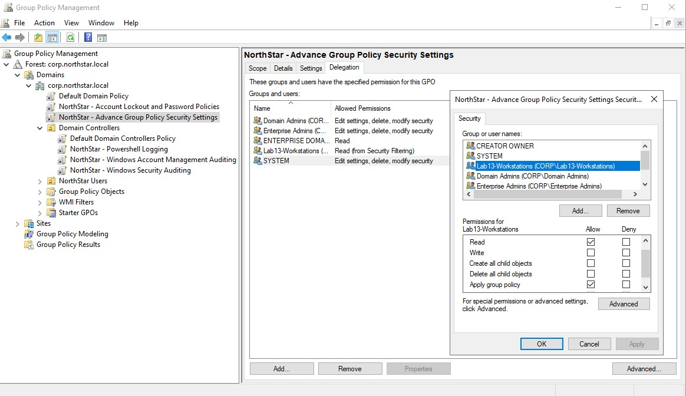

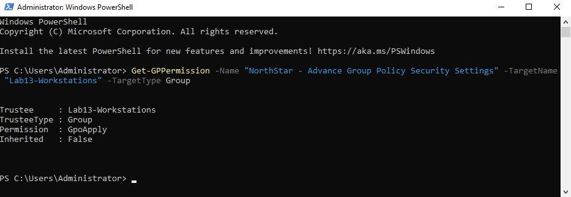

## 3. Configured Interactive Logon Security Options

Edited the new GPO and navigated to:

`Computer Configuration > Policies > Windows Settings > Security Settings > Local Policies > Security Options`

Configured the following settings.

### Don't Display Last Signed-In User

Enabled:

`Interactive logon: Don't display last signed-in`

This setting prevents Windows from displaying the username of the last signed-in user on the sign-in screen.

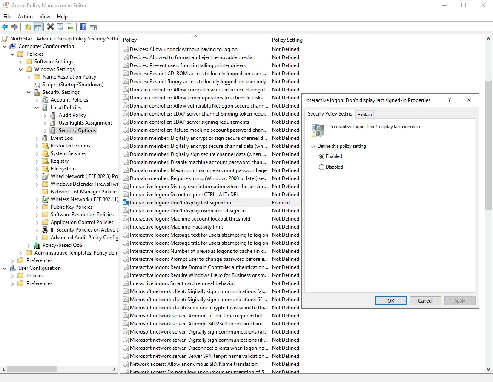

### Logon Warning Message Title

Configured:

`Interactive logon: Message title for users attempting to log on`

The following title was entered:

`NorthStar Technologies - Authorized Access`

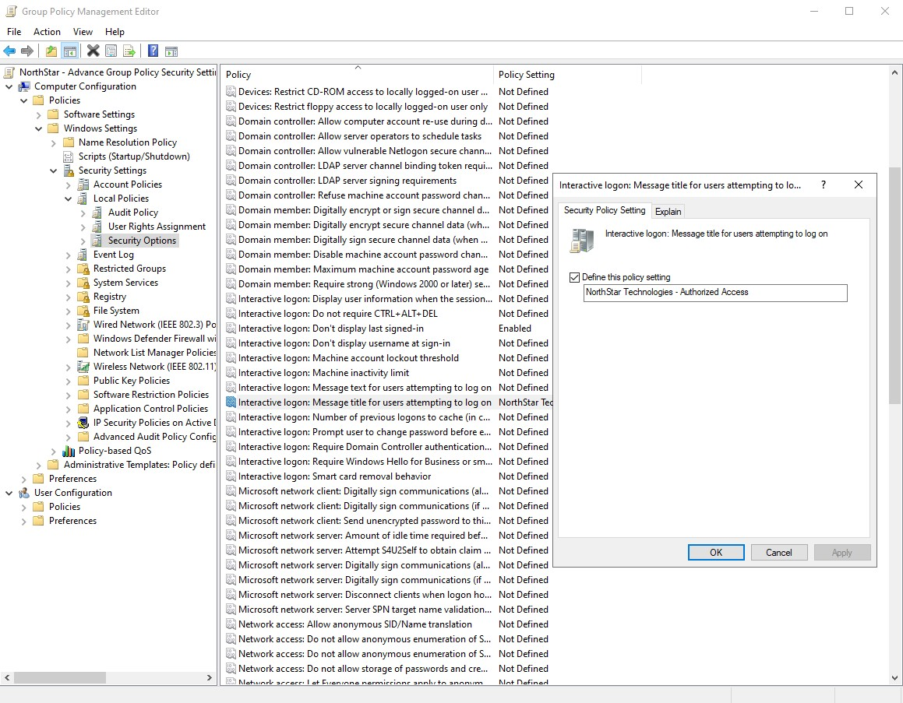

### Logon Warning Message Text

Configured:

`Interactive logon: Message text for users attempting to log on`

The following message was entered:

`This system is for authorized users only. Activity may be monitored.`

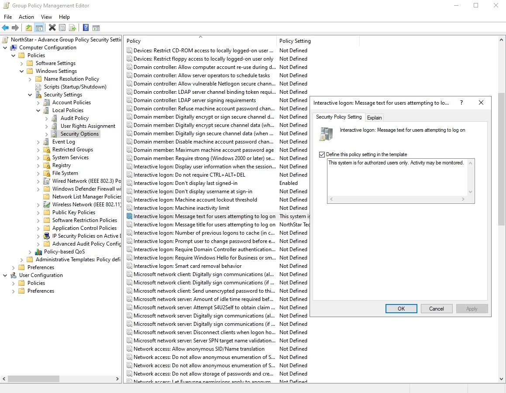

## 4. Applied and Verified Group Policy

On `WIN-CLIENT01`, opened Command Prompt as Administrator and applied the updated Group Policy configuration using:

```cmd
gpupdate /force
```

Verified the applied policies using:

```cmd
gpresult /r /scope computer
```

Confirmed that `NorthStar - Advanced Group Policy Security Settings` appeared under Applied Group Policy Objects.

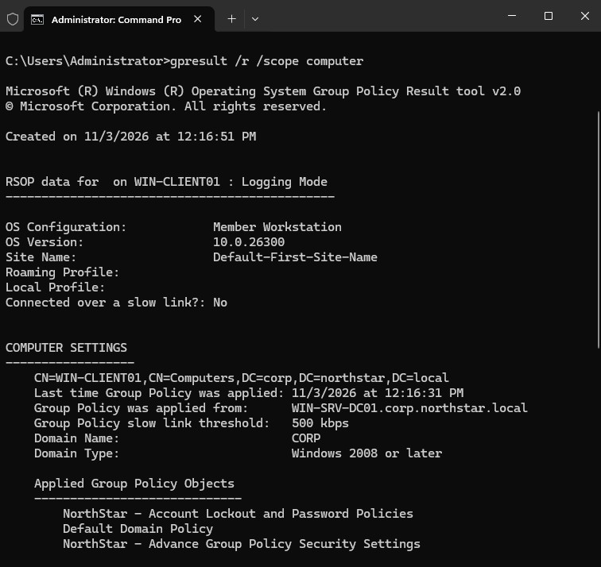

## 5. Verified Windows Sign-In Behavior

Signed out of the active session on `WIN-CLIENT01` to test the configured Interactive Logon settings.

The Windows sign-in screen displayed the configured warning title and message:

- Title: NorthStar Technologies - Authorized Access
- Message: This system is for authorized users only. Activity may be monitored.

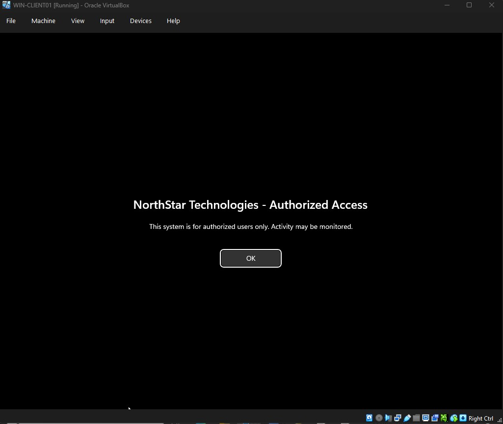

The previous administrator username was also hidden. Windows displayed the Other user sign-in option and required a username and password.

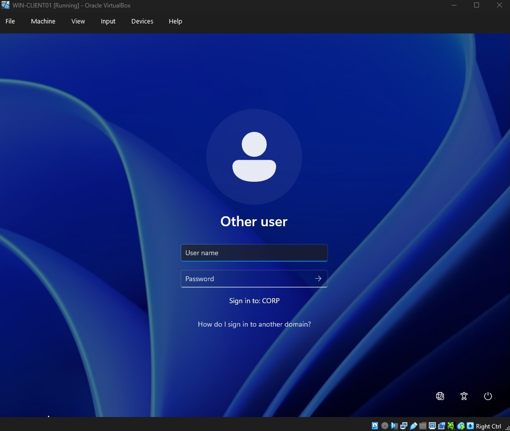

## 6. Verified GPO Security Filtering on the Domain Controller

Ran the following command on `WIN-SRV-DC01`:

```cmd
gpresult /r /scope computer
```

Checked the list of Group Policy Objects that were not applied because of filtering.

`NorthStar - Advanced Group Policy Security Settings` appeared with the following result:

`Filtering: Denied (Security)`

This was the expected result because `WIN-SRV-01` was not a member of `Lab13-Workstations`.

The GPO was successfully applied to `WIN-CLIENT01` but filtered out on the domain controller.

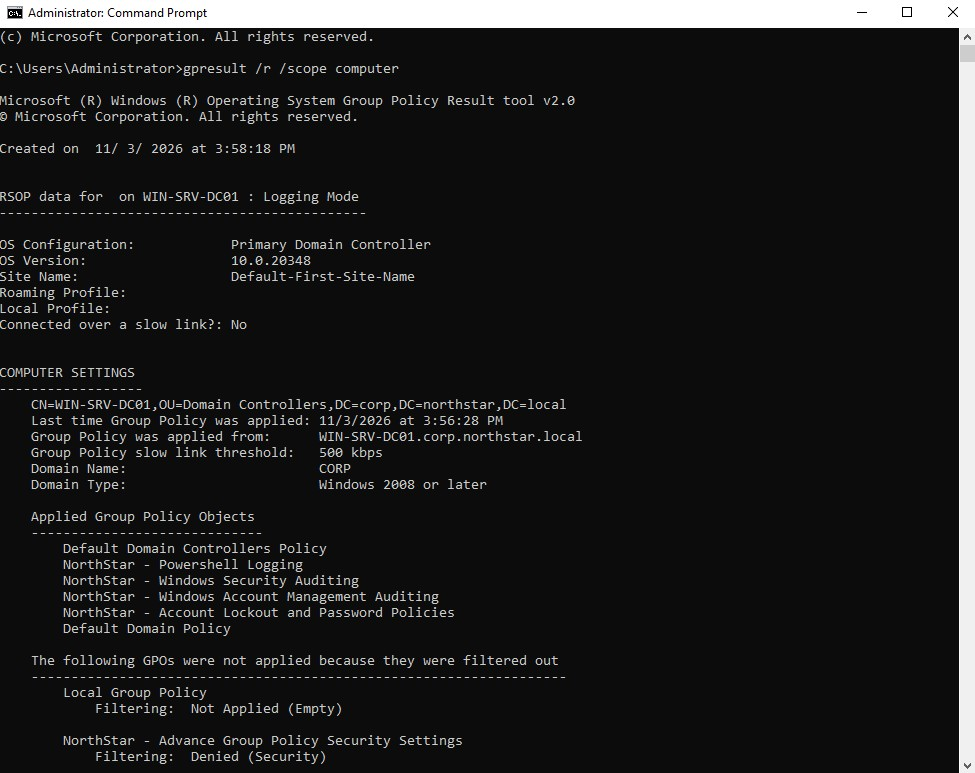

## 7. Findings

The lab demonstrated that:

- Security groups can be used to control which computers receive specific Group Policy settings.
- Security Filtering determines which users or computers have permission to apply a GPO.
- The `Get-GPPermission` PowerShell cmdlet can be used to inspect GPO permissions.
- Advanced security options can be configured centrally through Group Policy.
- The last signed-in username can be hidden from the Windows sign-in screen.
- Interactive Logon policies can display a customized warning before sign-in.
- The `gpresult` command can verify whether a GPO was applied or filtered out.

## Conclusion

Created and configured a dedicated Group Policy Object with security settings for a designated workstation.

Used Security Filtering to target `WIN-CLIENT01`, configured Interactive Logon options, and verified the resulting sign-in behavior. Also checked GPO permissions and confirmed that the policy was filtered out on the domain controller as intended.

This lab provided hands-on experience with Group Policy security settings, computer-based policy targeting, and GPO verification.
