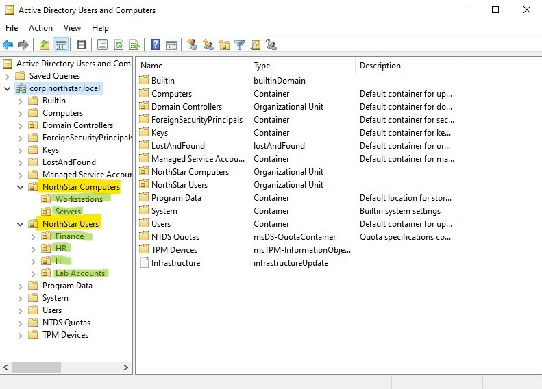
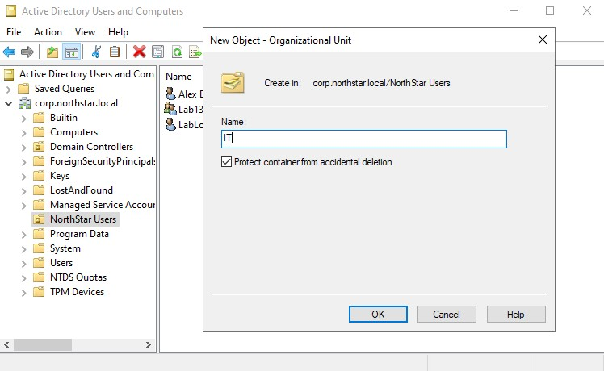
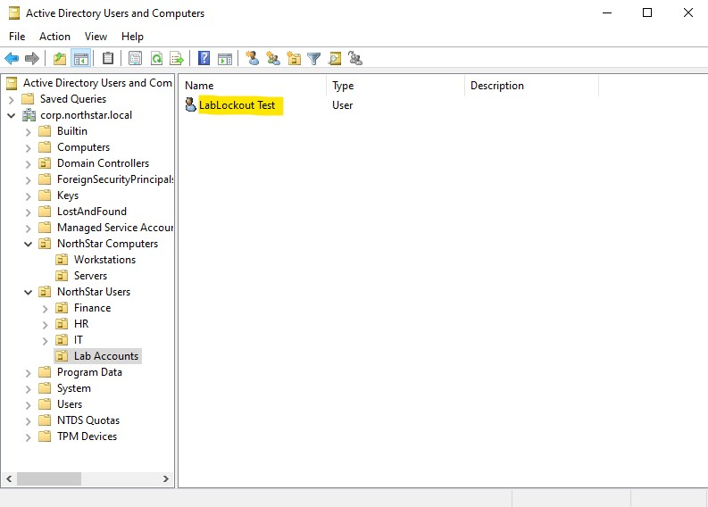
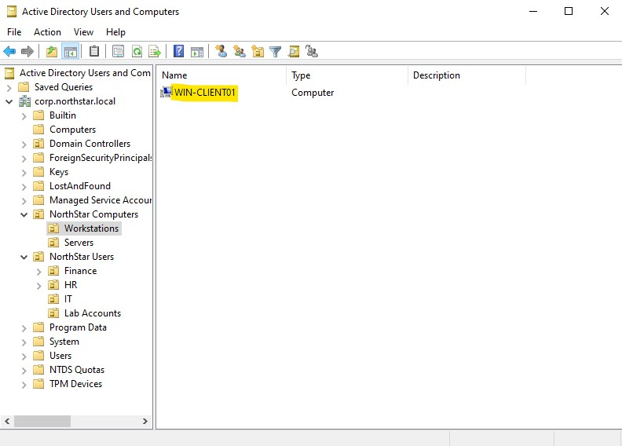
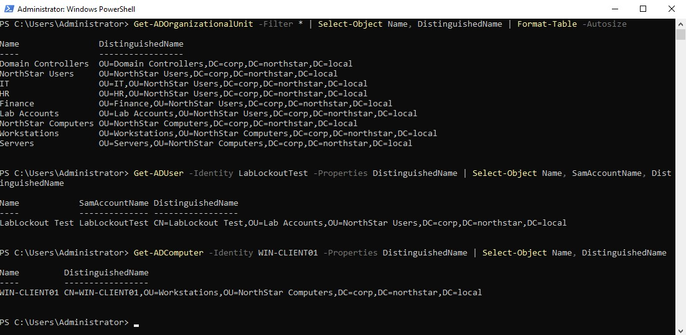
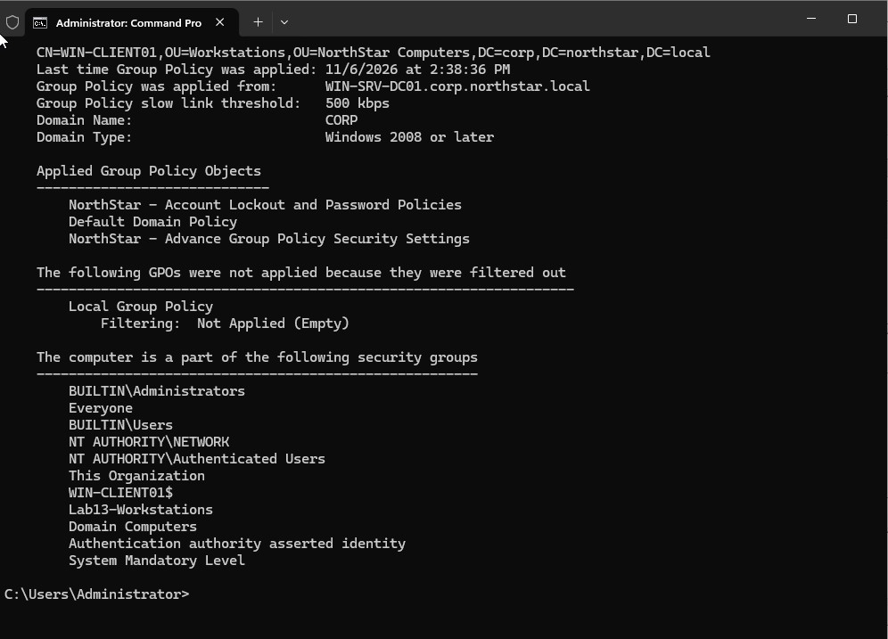

# Organizational Units (OU) Management

## Overview

This lab expands the existing Active Directory structure by creating Organizational Units (OUs) for user departments and computer accounts. Existing user and computer objects were moved into their designated OUs, and their locations were verified using PowerShell.

The lab also covers OU deletion protection and Group Policy inheritance after moving a domain-joined workstation.

## Objectives

- Create and organize nested Organizational Units.
- Separate user accounts from computer accounts.
- Enable protection against accidental deletion.
- Move existing Active Directory objects into their designated OUs.
- Verify OU structure and object locations using PowerShell.
- Check Group Policy processing after moving a workstation.

## Lab Environment

| Component | Configuration |
|---|---|
| Domain | `corp.northstar.local` |
| Domain Controller | `WIN-SRV-DC01` |
| Operating System | Windows Server 2022 |
| Client Computer | `WIN-CLIENT01` |
| Client Operating System | Windows 11 |
| Virtualization | Oracle VirtualBox |

## 1. Review Existing Active Directory Objects

Before making changes, the existing Active Directory structure and objects were reviewed.

The following objects were identified:

- `NorthStar Users` - Existing OU at the domain root.
- `LabLockoutTest` - Existing test user account.
- `Lab13-Workstations` - Security group used for Lab 13 GPO security filtering.
- `WIN-CLIENT01` - Domain-joined Windows 11 workstation.
- `WIN-SRV-DC01` - Domain controller located in the Domain Controllers OU.

The existing `Lab13-Workstations` security group was left in its original location.

## 2. Create User Organizational Units

Four child OUs were created under the existing `NorthStar Users` OU:

- `IT`
- `HR`
- `Finance`
- `Lab Accounts`

These OUs separate departmental accounts from test accounts.

## 3. Create Computer Organizational Units

A new OU named `NorthStar Computers` was created at the domain root.

Two child OUs were added:

- `Workstations`
- `Servers`

This separates workstation and server computer accounts instead of keeping them together in the default Computers container.

The resulting OU structure is shown below.

```text
corp.northstar.local
│
├── Domain Controllers
│   └── WIN-SRV-DC01
│
├── NorthStar Users
│   ├── IT
│   ├── HR
│   ├── Finance
│   └── Lab Accounts
│
└── NorthStar Computers
    ├── Workstations
    └── Servers
```



## 4. Enable Protection Against Accidental Deletion

Protection against accidental deletion was enabled on the newly created OUs.

This setting prevents an OU from being deleted accidentally through Active Directory Users and Computers. To delete a protected OU, the protection must first be disabled.

For existing OUs, the setting is available under the **Object** tab in the OU properties. Advanced Features must be enabled in Active Directory Users and Computers to display this tab.



## 5. Move Existing Active Directory Objects

The existing test user and workstation computer account were moved into their designated OUs.

### Move User Account

`LabLockoutTest` was moved from its original location into:

`NorthStar Users > Lab Accounts`



### Move Computer Account

`WIN-CLIENT01` was moved into:

`NorthStar Computers > Workstations`

The domain controller `WIN-SRV-DC01` remained in the built-in Domain Controllers OU.

The `Lab13-Workstations` security group was not moved.



Moving an object changes its location in Active Directory and its Distinguished Name (DN). Its Security Identifier (SID) remains unchanged.

## 6. Verify OU Structure and Object Locations Using PowerShell

PowerShell was used to check the new OU structure and confirm the locations of the user and computer accounts.

### List Organizational Units

```powershell
Get-ADOrganizationalUnit -Filter * |
Select-Object Name, DistinguishedName |
Format-Table -AutoSize
```

### Check User Account Location

```powershell
Get-ADUser -Identity LabLockoutTest -Properties DistinguishedName |
Select-Object Name, SamAccountName, DistinguishedName
```

Expected Distinguished Name:

```text
CN=LabLockoutTest,OU=Lab Accounts,OU=NorthStar Users,DC=corp,DC=northstar,DC=local
```

### Check Computer Account Location

```powershell
Get-ADComputer -Identity WIN-CLIENT01 -Properties DistinguishedName |
Select-Object Name, DistinguishedName
```

Expected Distinguished Name:

```text
CN=WIN-CLIENT01,OU=Workstations,OU=NorthStar Computers,DC=corp,DC=northstar,DC=local
```

The PowerShell output was reviewed to confirm that both objects were located in their intended OUs.



## 7. Verify Group Policy Inheritance

After moving `WIN-CLIENT01` into the `Workstations` OU, the computer's Group Policy processing was checked.

The `NorthStar - Advanced Group Policy Security Settings` GPO was previously linked at the domain level in Lab 13. Its security filtering targets the `Lab13-Workstations` security group.

Because the workstation remains a member of that group, it should continue to qualify for the GPO after being moved into the new OU.

The workstation was restarted, and the following commands were run from an elevated Command Prompt:

```powershell
gpupdate /force
```

```powershell
gpresult /r /scope computer
```

The output was checked for `NorthStar - Advanced Group Policy Security Settings` under Applied Group Policy Objects.



## 8. Final Active Directory Structure

The final structure separates user accounts by department and computer accounts by function.

```text
corp.northstar.local
│
├── Domain Controllers
│   └── WIN-SRV-DC01
│
├── NorthStar Users
│   ├── IT
│   ├── HR
│   ├── Finance
│   └── Lab Accounts
│       └── LabLockoutTest
│
└── NorthStar Computers
    ├── Workstations
    │   └── WIN-CLIENT01
    └── Servers
```

## Key Takeaways

- OUs organize users, computers, and other Active Directory objects.
- Nested OUs allow objects to be grouped under a parent OU.
- GPOs can be linked to OUs but not directly to ordinary AD containers.
- Protection against accidental deletion helps prevent unintended OU deletion.
- Moving an object changes its Distinguished Name but does not change its SID.
- Moving a computer into another OU can affect which OU-linked GPOs it receives.
- Domain-linked GPOs can continue to apply to computers in child OUs, provided the policy scope and filtering requirements are met.
