# Active Directory Security Groups and Group-Based Access Management

## Objective

The purpose of this lab was to understand how Active Directory security groups are used to organize users and manage access to network resources.

The exercises covered Global, Domain Local, and Universal group scopes, group nesting, the AGDLP model, and the assignment of NTFS and Share permissions. A test account was used to verify how group membership controls access to a shared folder.

## Lab Environment

- **Domain:** `corp.northstar.local`
- **Domain Controller:** `WIN-SRV-DC01`
- **Client Workstation:** `WIN-CLIENT01`
- **Operating System:** Windows Server 2022 and Windows 11
- **Tools:** Active Directory Users and Computers, Windows PowerShell

## 1. Creating the Security Groups OU

A dedicated OU named `Security Groups` was created under `NorthStar Users` to keep the security groups organized and separate from user accounts.

Protection against accidental deletion was enabled for the OU.

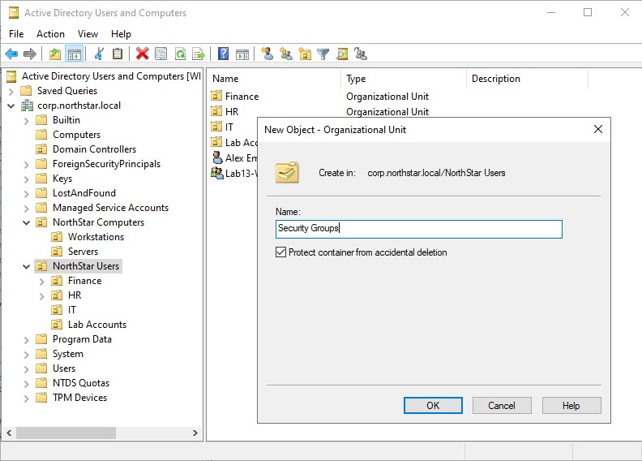

## 2. Creating Security Groups

Three security groups were created under `NorthStar Users\Security Groups`. Each group was configured with a different scope to understand how Global, Domain Local, and Universal groups are used in an Active Directory environment.

### Global Group: GG-IT-Helpdesk

The Global security group was created to organize IT department accounts. Global groups are commonly used to group users according to their department or job role.

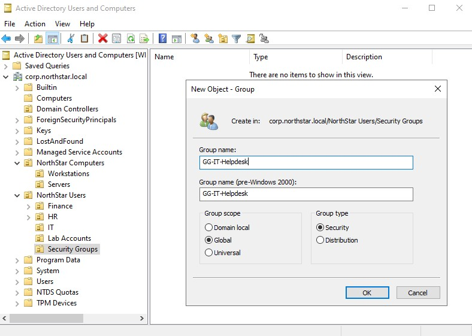

### Domain Local Group: DL-IT-Resources

The Domain Local security group was created to manage access to IT resources within the domain. This group would receive the permissions assigned to the shared folder.

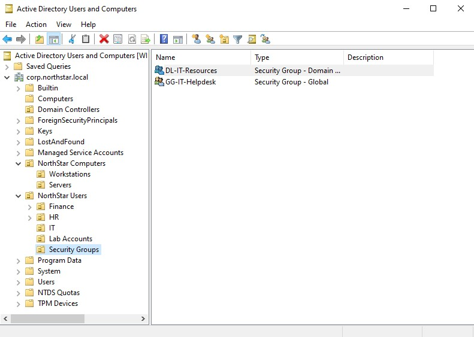

### Universal Group: UG-Enterprise-IT

A Universal security group was created to demonstrate a group scope that can include users and groups from different domains within the same forest.

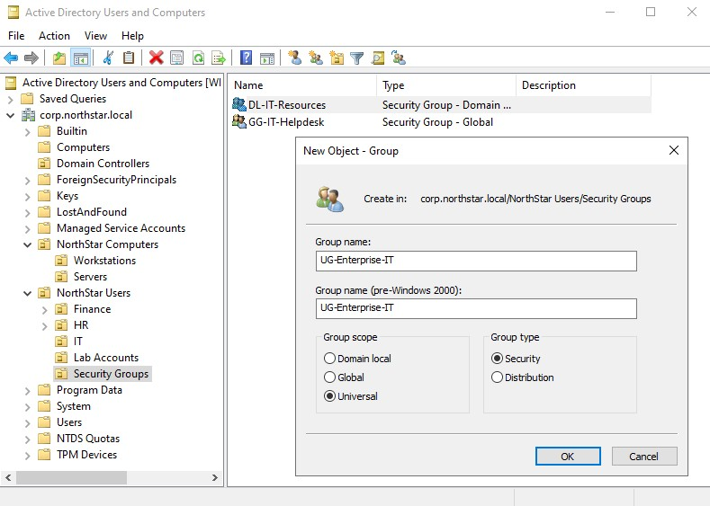

The three groups were checked in Active Directory Users and Computers to confirm that they were created successfully.

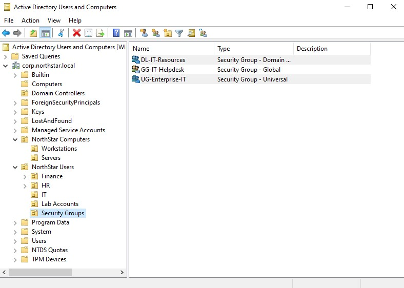

## 3. Adding a User to a Global Group

The existing test account `LabLockoutTest`, located under `NorthStar Users\Lab Accounts`, was added to `GG-IT-Helpdesk`.

This demonstrated how user accounts can be assigned to a group based on their department or role rather than managing access individually.

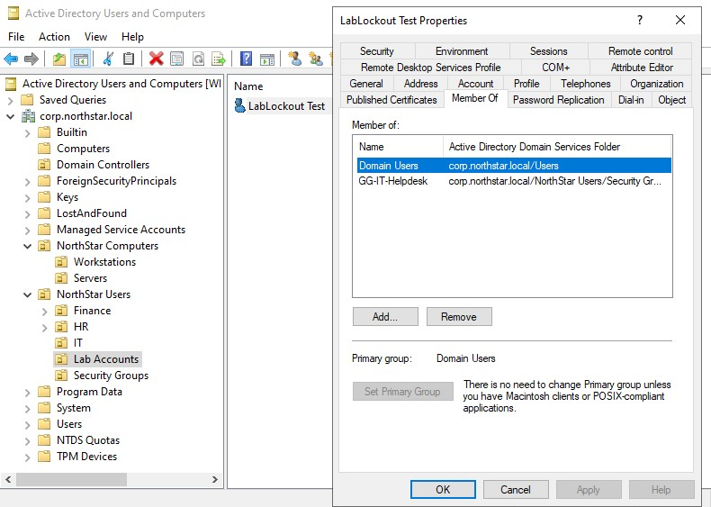

The group's Members tab was also checked to confirm that `LabLockoutTest` appeared in the membership list.

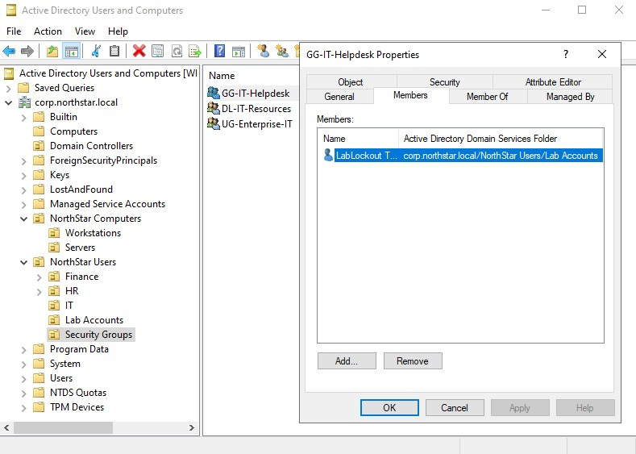

## 4. Group Nesting and the AGDLP Model

The Global group `GG-IT-Helpdesk` was added as a member of the Domain Local group `DL-IT-Resources`.

This demonstrated group nesting and how permissions can be managed through multiple levels of groups.

The structure followed the AGDLP model:

- **A – Accounts:** Individual user accounts.
- **G – Global Groups:** Organize users by department or role.
- **DL – Domain Local Groups:** Receive permissions to resources.
- **P – Permissions:** Access assigned to files, folders, and other resources.

The resulting structure was:

```text
LabLockoutTest
       |
       v
GG-IT-Helpdesk (Global)
       |
       v
DL-IT-Resources (Domain Local)
       |
       v
IT-Shared Folder Permissions
```

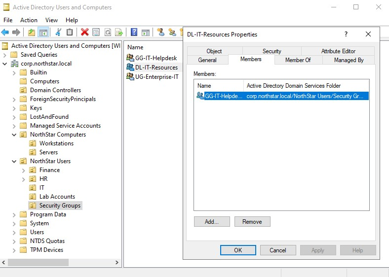

## 5. Verifying Group Membership and Scope with PowerShell

PowerShell was used to verify group membership and confirm the scope and category of each security group.

The following commands were used to check the nested membership:

```powershell
Get-ADGroupMember -Identity "DL-IT-Resources"

Get-ADGroupMember -Identity "DL-IT-Resources" -Recursive
```

The first command displayed the Global group nested inside the Domain Local group. The second command displayed the underlying user membership through the nested group.

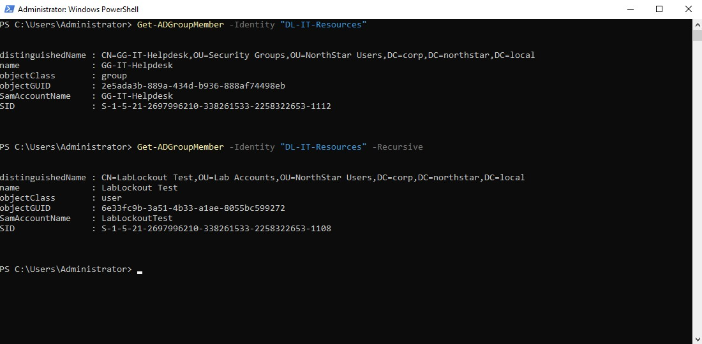

The following command was used to check the group scopes and categories:

```powershell
Get-ADGroup -Filter * -SearchBase "OU=Security Groups,OU=NorthStar Users,DC=corp,DC=northstar,DC=local" -Properties GroupScope,GroupCategory |
Select-Object Name, GroupScope, GroupCategory
```

The results confirmed the following:

| Group | Scope | Category |
|---|---|---|
| GG-IT-Helpdesk | Global | Security |
| DL-IT-Resources | DomainLocal | Security |
| UG-Enterprise-IT | Universal | Security |

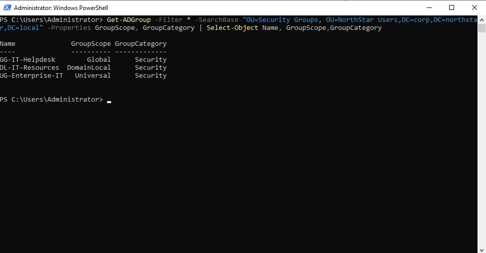

## 6. Creating the IT Shared Folder

A test folder named `IT-Shared` was created on the Domain Controller under `C:\`.

A text file named `IT-Test-Document.txt` was placed inside the folder. This file was used to test whether the group-based permissions would allow a user to access and modify its contents.

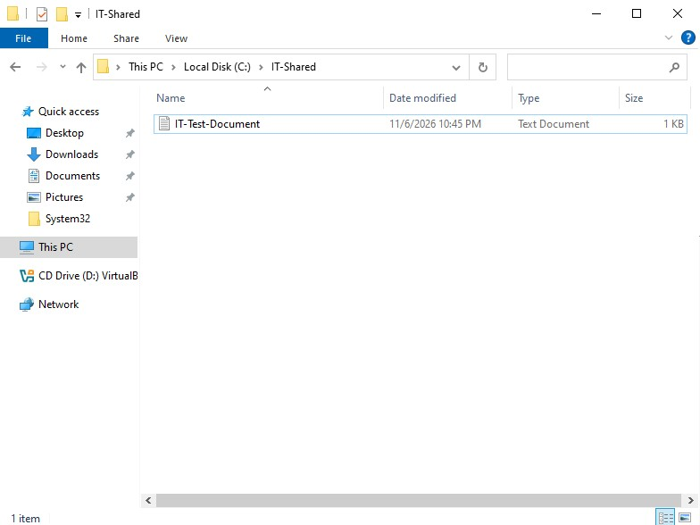

## 7. Assigning NTFS Permissions

The Security tab of the `IT-Shared` folder was used to assign permissions to `DL-IT-Resources`.

The group was added with **Modify** permission.

Modify permission allows members to read, create, edit, and delete files and folders without giving them Full Control.

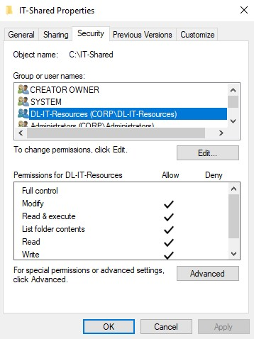

## 8. Configuring Share Permissions

The folder was shared over the network using Advanced Sharing.

The default `Everyone` entry was removed, and `DL-IT-Resources` was added with the following permissions:

- Read
- Change

Full Control was left unchecked.

This allowed members of the Domain Local group to access and modify the shared folder over the network without being able to change the share permissions.

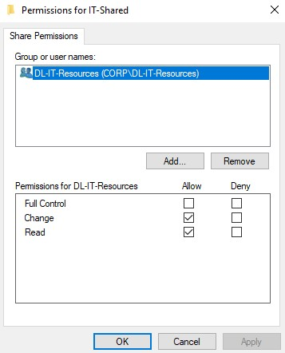

## 9. Testing Group-Based Access

The Windows 11 client was used to test access to the shared folder.

The test account `CORP\LabLockoutTest` was signed in on `WIN-CLIENT01` and connected to the shared folder using:

```text
\\WIN-SRV-DC01\IT-Shared
```

The account was able to open the folder and view `IT-Test-Document.txt`.

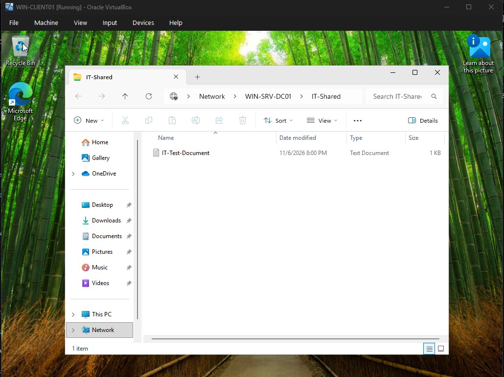

The document was then edited and saved from the client workstation. This confirmed that the account had Modify access through its group membership.

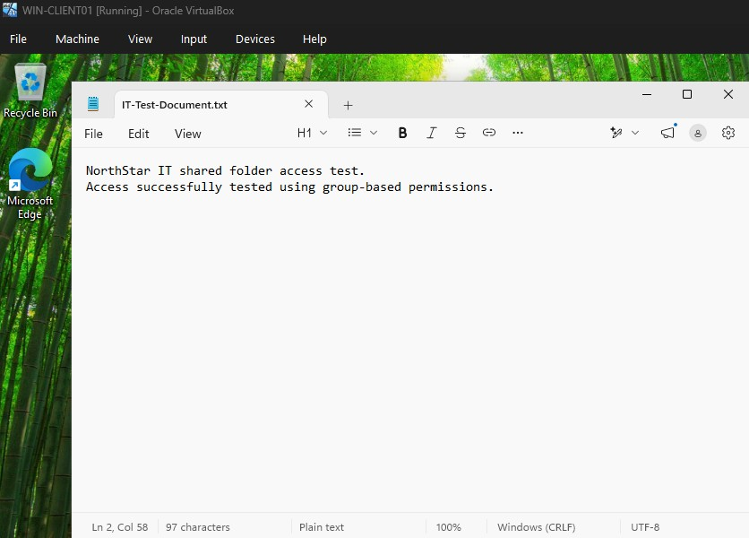

The updated document was also checked on the Domain Controller to confirm that the changes were saved to the original file.

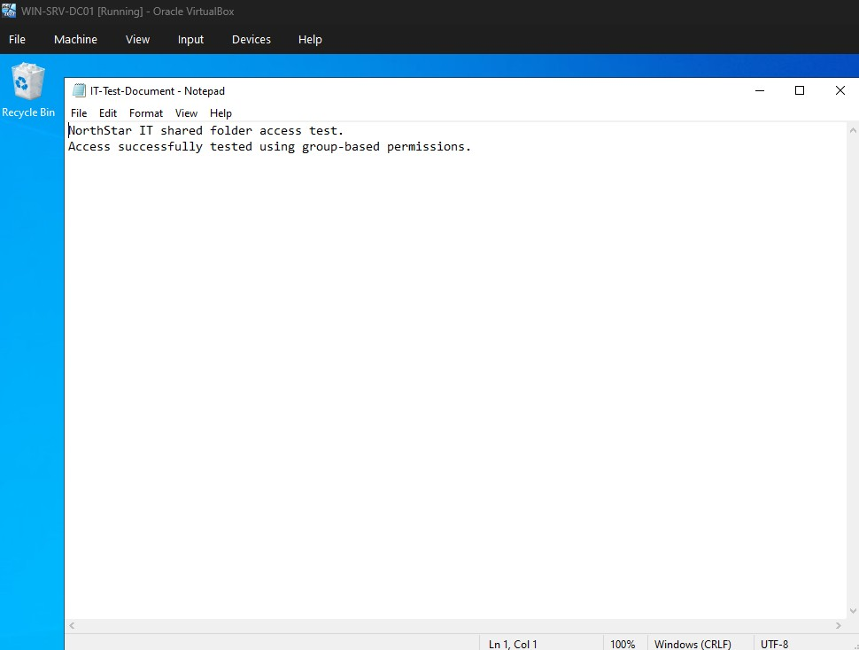

## 10. Testing Access Revocation

To simulate an employee leaving the IT department, `LabLockoutTest` was removed from `GG-IT-Helpdesk`.

The account's Member Of tab was checked to confirm that the Global group was no longer listed.

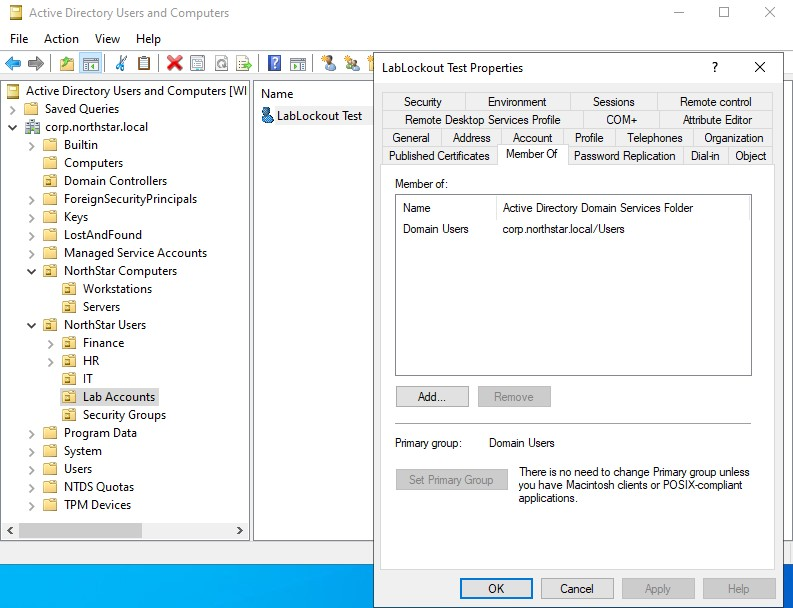

After signing out and signing back in, the account was tested again against the same network share.

The server remained reachable, and the `IT-Shared` network share was still visible. However, the test account received an access-denied message when attempting to open the folder.

This confirmed that removing the account from the Global group removed its inherited access through the nested Domain Local group.

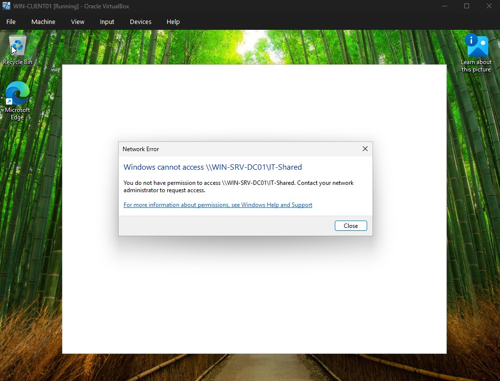

After the test, `LabLockoutTest` was added back to `GG-IT-Helpdesk` to restore the original lab configuration.

## Key Takeaways

The following concepts were covered during this lab:

1. **Group scopes:** Global groups organize users, Domain Local groups are commonly used to assign permissions to resources, and Universal groups support grouping across domains within a forest.

2. **Group nesting and AGDLP:** Users can be placed into Global groups, which are then nested inside Domain Local groups that receive resource permissions. This makes access easier to manage.

3. **NTFS and Share permissions:** NTFS permissions control access to files and folders, while Share permissions apply when resources are accessed over the network. Both are evaluated during network access, and the more restrictive effective permission applies.

4. **Group-based access management:** Adding or removing a user from a Global group can grant or revoke access through the existing group structure without assigning permissions directly to the individual account.

5. **PowerShell verification:** Active Directory PowerShell commands can be used to inspect group membership, group nesting, and group scope.

6. **Access troubleshooting:** Successful authentication and network connectivity do not automatically mean a user has permission to access a resource. Group membership, nesting, Share permissions, NTFS permissions, and the user's logon token all need to be considered.

## Conclusion

This lab demonstrated how Active Directory security groups can be used to manage access to shared resources. By using group nesting and the AGDLP model, permissions can be assigned at the group level instead of being managed separately for each user.

The access tests also showed how group membership changes affect resource access. Adding the test account to the appropriate Global group granted access, while removing it revoked access through the nested group structure.
