# Lab 16: File Sharing and NTFS Permissions

## Overview

This lab focuses on configuring file sharing and managing NTFS permissions for separate department folders in an Active Directory environment. Separate IT and HR folders were created, with access controlled through department-specific security groups.

The lab also involved testing network access, verifying file modification permissions, and confirming that access could be revoked and restored through changes to group membership.

## Lab Environment

- **Domain:** `corp.northstar.local`
- **Domain Controller:** `WIN-SRV-DC01` (Windows Server 2022)
- **Client:** `WIN-CLIENT01` (Windows 11)
- **Virtualization:** Oracle VirtualBox
- **Existing Shared Folder:** `C:\IT-Shared`

## Objectives

- Create separate folders for IT and HR.
- Review NTFS permission inheritance.
- Configure department-specific NTFS permissions.
- Create a separate network share for HR.
- Configure share permissions using a domain local security group.
- Test folder access and file modification from a domain client.
- Verify that removing group membership revokes access.
- Confirm that changes to HR access do not affect existing IT access.

## 1. Create the Department Folder Structure

Created a `Lab16-FilePermissions` folder under `C:\IT-Shared` on the domain controller.

Two department folders were created:

- `IT`
- `HR`

This structure provides separate locations for department files and allows permissions to be managed independently.

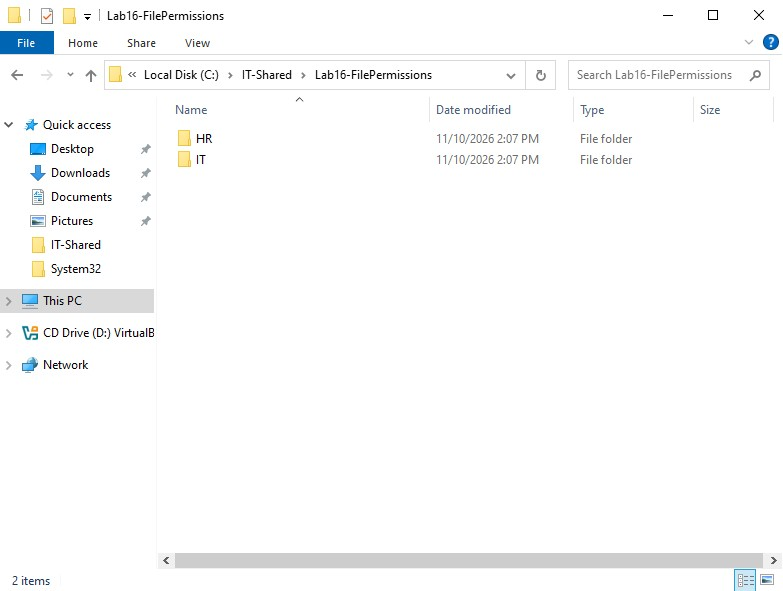

## 2. Examine NTFS Permission Inheritance

Reviewed the HR folder's Advanced Security Settings to identify the permissions inherited from its parent folder.

The HR folder initially inherited permissions from `C:\IT-Shared`, including Modify access for `DL-IT-Resources`.

To separate HR access from the existing IT permissions, inheritance was disabled. The option to convert inherited permissions into explicit permissions was selected.

The inherited `DL-IT-Resources` entry was then removed from the HR folder.

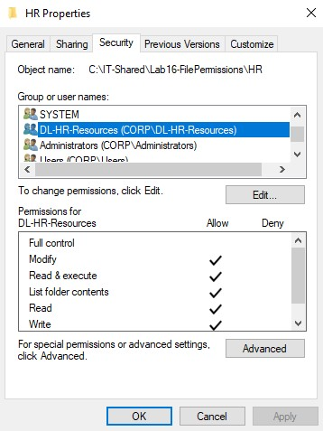

## 3. Create a Department-Specific Security Group

Created a new security group in Active Directory to manage access to the HR folder.

- **Group Name:** `DL-HR-Resources`
- **Group Scope:** Domain Local
- **Group Type:** Security
- **Location:** `NorthStar Users\Security Groups`

This group provides a centralized way to assign HR folder permissions through group membership.

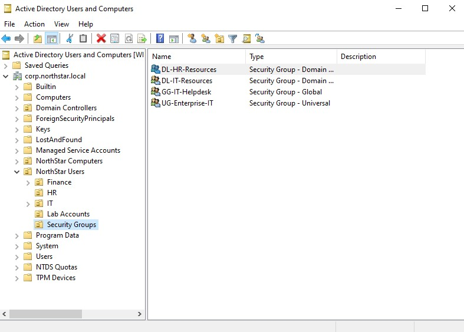

## 4. Configure HR NTFS Permissions

Added `DL-HR-Resources` to the HR folder's NTFS permissions and assigned Modify access.

This allows members of the group to create, edit, and delete files within the HR folder without relying on the existing IT security group's permissions.

Verified the updated permissions in the HR folder's Advanced Security Settings.

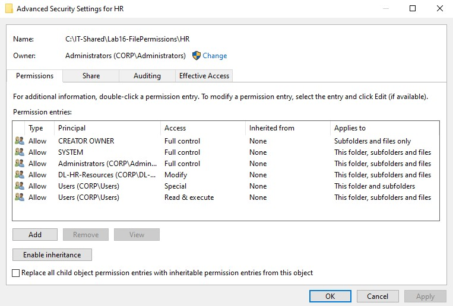

## 5. Verify IT Folder Permissions

Reviewed the IT folder's NTFS permissions to confirm that it continued to inherit access from its parent folder.

The existing `DL-IT-Resources` group retained Modify access to the IT folder.

No changes were made to the existing IT permission configuration.

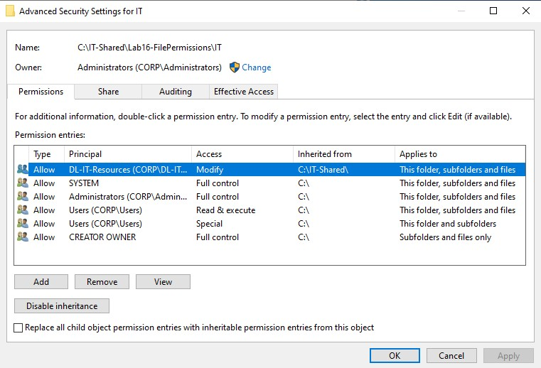

## 6. Assign HR Group Membership

Added the test account `LabLockoutTest` as a member of `DL-HR-Resources`.

This account was used to verify that HR folder access was controlled by membership in the department-specific security group.

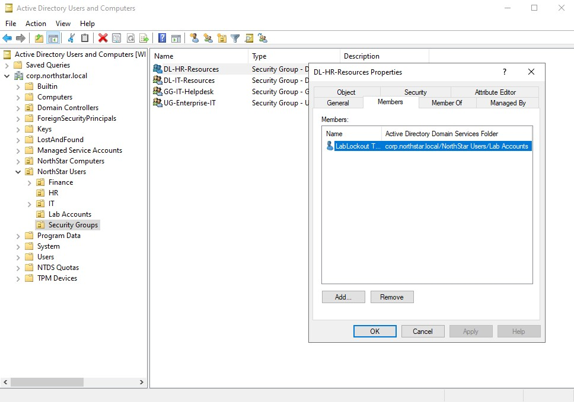

## 7. Create a Separate HR Network Share

Created a separate network share named `HR-Shared`, pointing to:

`C:\IT-Shared\Lab16-FilePermissions\HR`

Updated the share permissions by removing the default `Everyone` entry and adding `DL-HR-Resources`.

The group was assigned:

- Change
- Read

Full Control was not granted.

This configuration allows members of the HR group to access and modify files through the network share, while NTFS permissions continue to control access at the folder level.

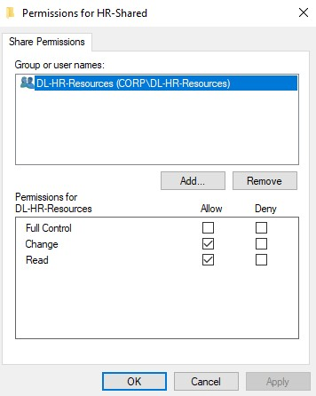

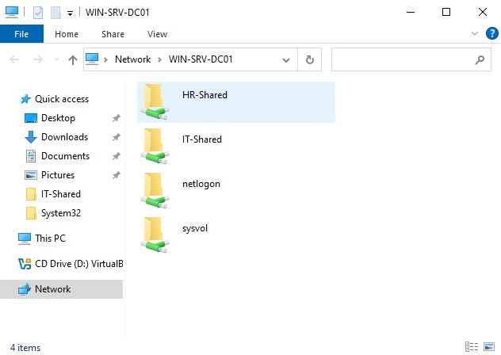

## 8. Test HR Network Access

Signed in to the Windows 11 client using the test account:

`CORP\LabLockoutTest`

Accessed the HR network share through:

`\\WIN-SRV-DC01\HR-Shared`

The account was able to open the shared folder successfully.

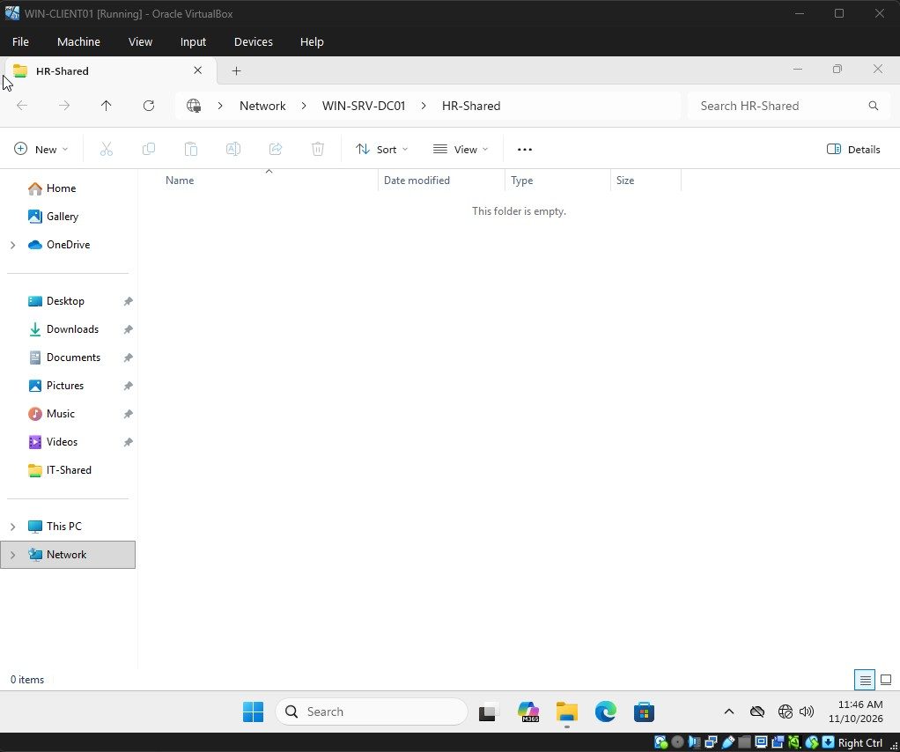

## 9. Test HR Modify Permissions

Created a test file named `HR-Access-Test.txt` from the Windows 11 client.

The file contained the following text:

`HR folder Modify permission successfully tested.`

Verified that the file was created successfully and was also visible on the domain controller.

This confirmed that the account had the required Modify permissions on the HR folder.

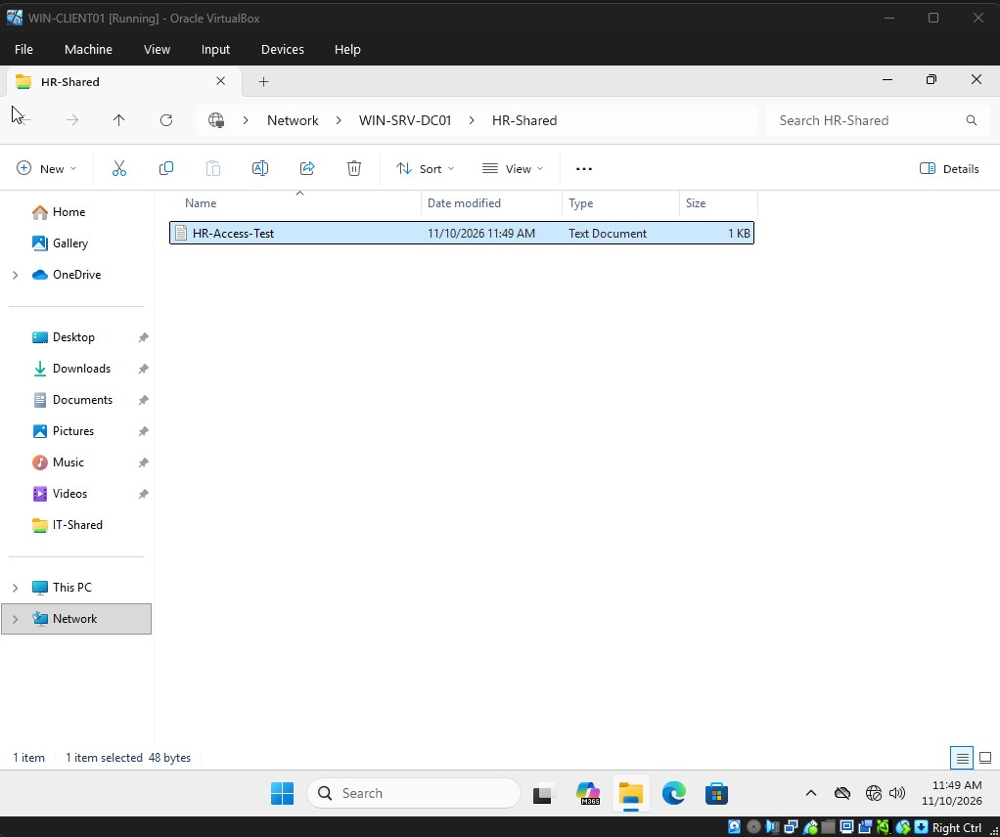

## 10. Verify Existing IT Access

Accessed the existing IT network share from the Windows 11 client:

`\\WIN-SRV-DC01\IT-Shared`

The test account was able to open the share and access `IT-Test-Document.txt`.

The existing IT access was provided through the following group membership and permission structure:

**LabLockoutTest** (User Account)

↓ Member of

**GG-IT-Helpdesk** (Global Security Group)

↓ Nested inside

**DL-IT-Resources** (Domain Local Security Group)

↓ Assigned permissions to

**IT-Shared** (Shared Folder)

This verified that the existing IT access configuration remained functional alongside the separate HR permissions.

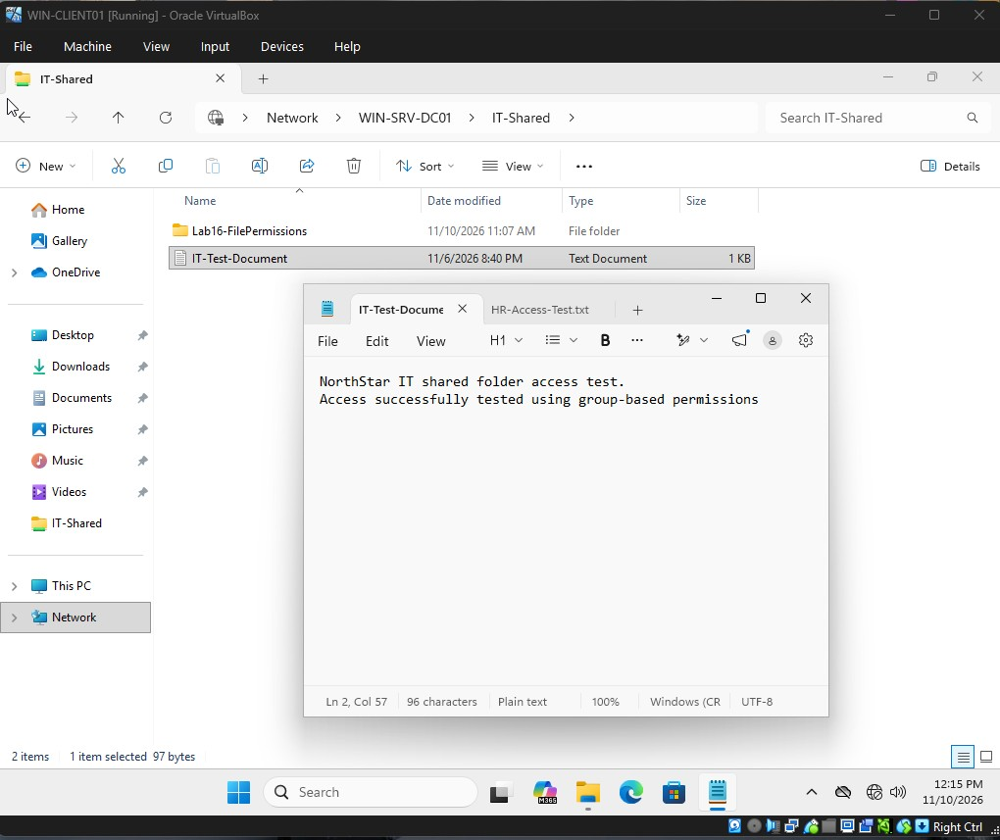

## 11. Test HR Access Revocation

Removed `LabLockoutTest` from the `DL-HR-Resources` group in Active Directory.

After signing out and signing back in to refresh the user's security token, attempted to access the HR network share again.

Access was denied, confirming that HR access was controlled by membership in the department-specific security group.

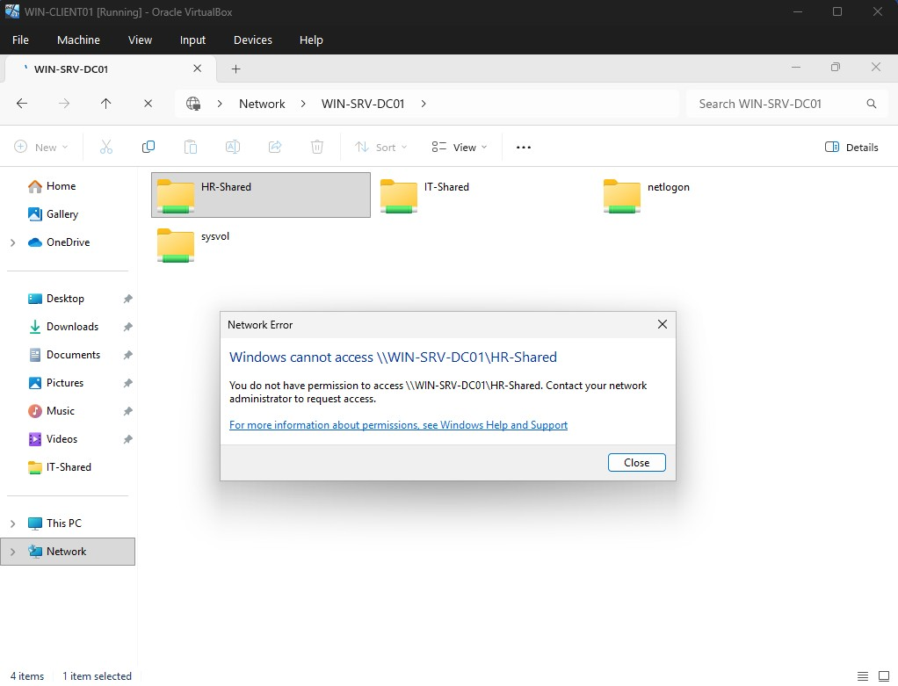

## 12. Verify IT Access After HR Access Revocation

After removing the test account from `DL-HR-Resources`, accessed the existing IT network share again.

The account could still open the IT share and access its files.

This confirmed that removing HR group membership did not affect the account's existing IT access.

## 13. Restore HR Group Membership

Added `LabLockoutTest` back to `DL-HR-Resources`.

After signing out and signing back in, accessed the HR network share again.

Access was successfully restored, confirming that HR permissions were applied through the department-specific security group.

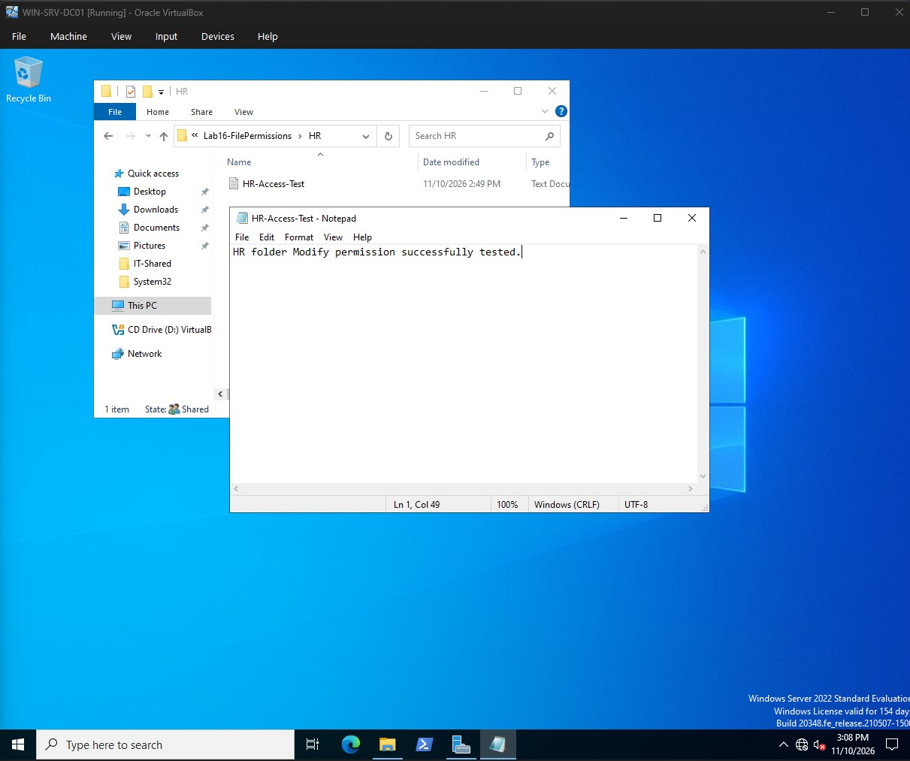

## Key Takeaways

### NTFS Permissions and Inheritance

- NTFS permissions determine what users can do with files and folders.
- Child folders inherit permissions from their parent folders unless inheritance is disabled.
- Inheritance can be disabled to apply separate permissions to specific folders.

### Share Permissions

- Share permissions control access to folders over the network.
- Share permissions and NTFS permissions work together when accessing shared folders remotely.
- The more restrictive permission determines the user's effective network access.

### Group-Based Access Management

- Security groups provide a centralized way to manage access.
- Adding or removing a user from a group can grant or revoke access without changing the folder's permission entries.
- Separate department groups help keep access to shared resources organized.

### Access Verification

- Tested access from a domain-joined Windows client.
- Confirmed that the HR account could create and modify files.
- Verified that removing HR group membership revoked HR access.
- Confirmed that IT access remained available after HR access was removed.
- Restored HR access by adding the account back to the appropriate group.

## Conclusion

This lab demonstrated how to configure separate department folders, manage NTFS permission inheritance, and create network shares with department-specific access.

Access was tested from a domain-joined client to verify that users could access and modify authorized resources. Group membership was also changed to confirm that access could be revoked and restored without modifying the underlying folder permissions.

The lab reinforced the importance of combining NTFS permissions, share permissions, and Active Directory security groups to manage access to shared resources.
